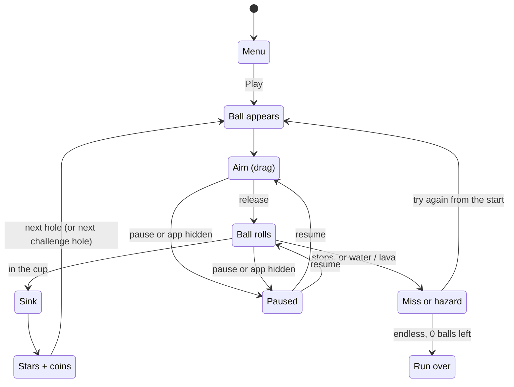
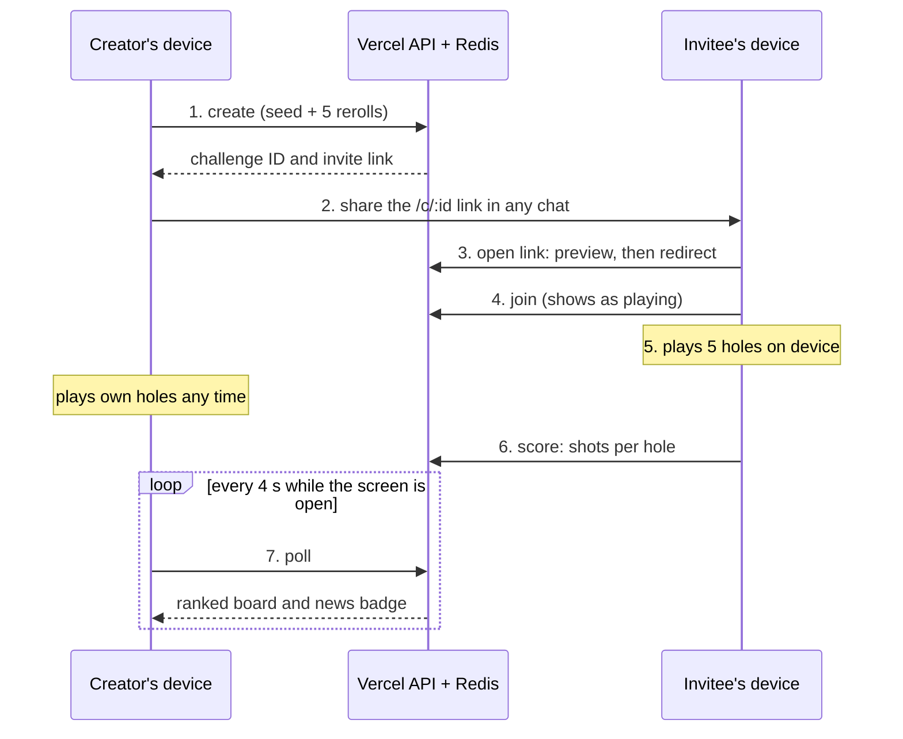
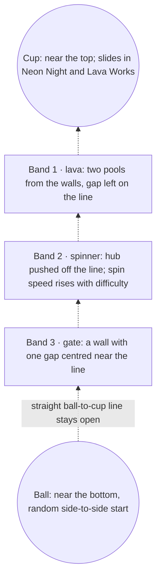
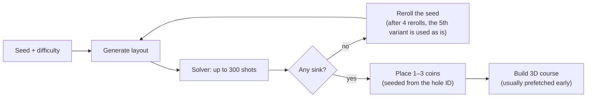
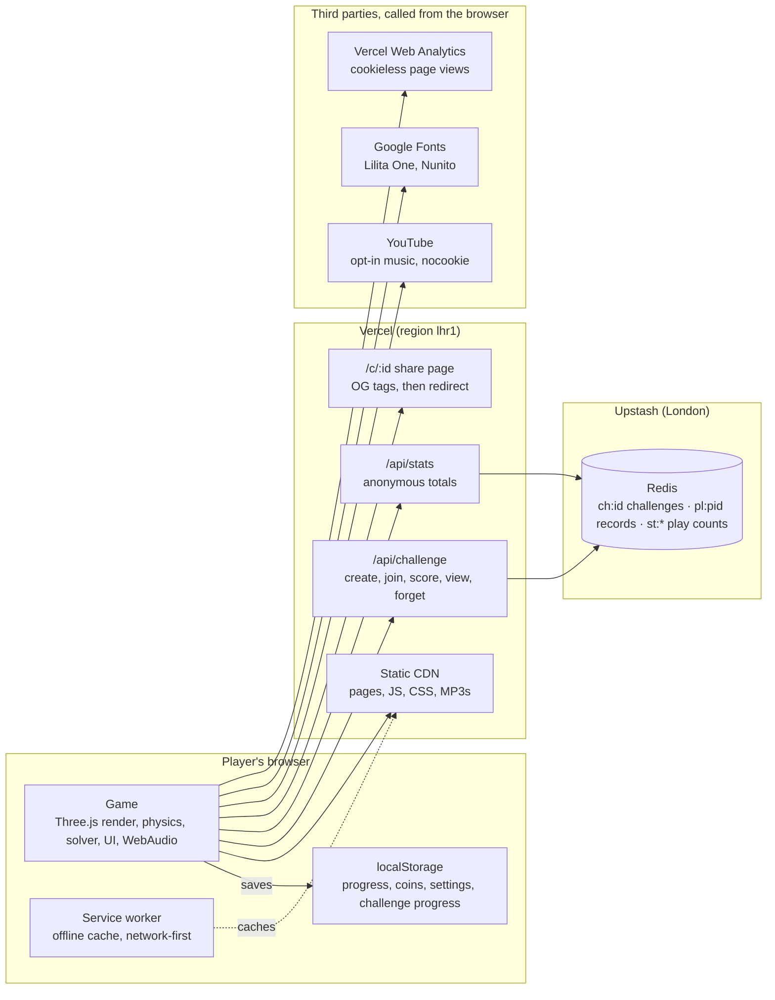
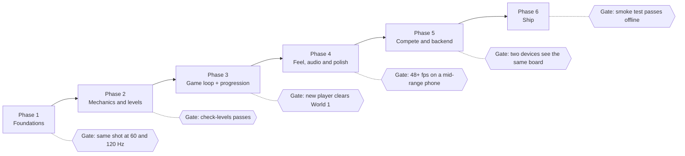

# Holeshot — Product Requirements Document

Last updated 18 October 2026 · Owner: Bright

## 1. Overview

Holeshot is a free, account-free 3D browser game where the player gets the ball in the cup with one drag-and-release shot per attempt. It runs on phones and desktops as an installable, offline-capable PWA, and is live at [playholeshot.vercel.app](https://playholeshot.vercel.app).

**Pitch.** Drag back anywhere, aim, release. Each hole is a small, hand-tuned or generated physics puzzle — spinners, bumpers, portals, ice, lava — that takes seconds to try and a few attempts to master. Five themed worlds, 60 holes, a daily hole, endless mode, and Compete: asynchronous 5-hole challenges you send to friends as a link.

**Vision.** The most satisfying one-thumb shot on the web: instant to open, no install or sign-up required, smooth on a mid-range phone, and fair — every hole is provably solvable.

**Product principles**

- **Zero friction.** No accounts, no ads, no downloads. A link opens straight into play.
- **Feel first.** Slow motion on the drop, near-miss reactions, camera shake, particles, synthesised sound and haptics.
- **Fair by construction.** A brute-force solver verifies every hole has at least one sinking shot before it ships or is served.
- **Private by default.** Progress lives on the device. The server stores only challenge scores and anonymous running totals.
- **Runs anywhere.** WebGL on any modern browser, adaptive graphics tiers, and a full offline mode.

**Status.** v1.0.0 is in production on Vercel (single static site + three serverless functions + Upstash Redis). This PRD describes the shipped product as the baseline, written so a team could rebuild it from scratch.

**Conventions.** Requirement IDs use a prefix per area (e.g. `FR-PLAY-03`, `NFR-PERF-01`). Priority is MoSCoW: **Must** = v1 cannot ship without it; **Should** = shipped in v1, can slip; **Could** = nice-to-have. World units: `x` runs across the course, `z` runs along it; the ball starts toward `+z` and the hole sits toward `−z`.

## 2. Problem, goals and success metrics

Holeshot exists because most casual mobile games are behind an app-store install, an account, ads or a paywall, and most web games feel cheap. The goal is a web game that feels native, starts in one tap and is worth coming back to daily.

**Problems it solves**

- **Friction to play.** Store installs and sign-ups lose most people before the first shot. Holeshot opens from a link and plays immediately.
- **Friction to play together.** Real-time multiplayer needs both players online at once. Compete is asynchronous: send a link, everyone plays when they like.
- **Shallow web games.** Browser games rarely have tactile feel. Holeshot invests in physics, juice and audio so a single shot is satisfying.
- **Unfair generated content.** Procedural levels are often impossible. Every Holeshot hole is verified solvable by a solver before it is served.

**Goals (v1)**

1. Ship a complete single-player game: 5 worlds × 12 holes, daily hole, endless mode, shop.
2. Ship Compete: async 5-hole challenges shared by link, with no accounts.
3. Run at a steady 60 fps on mid-range phones via adaptive graphics; play fully offline once loaded.
4. Measure reach and retention without collecting any personal data.

**Non-goals (v1)**

- User accounts, logins, cloud save or cross-device sync.
- Real-time multiplayer, chat, friend lists or global leaderboards.
- Ads, in-app purchases or real-money currency. Coins are earned only by playing.
- Native app-store builds (a Capacitor path is documented but not shipped).
- A level editor for players.
- Anti-cheat on Compete scores (the API trusts the client; see Risks).

**Success metrics**

All metrics come from the anonymous `/api/stats` totals and Vercel Web Analytics. No per-user tracking exists, so every metric is an aggregate.

| Metric | Definition | Source | Proposed target |
| --- | --- | --- | --- |
| New players | Devices reporting `first: true` per day | `/api/stats` | Growth week over week |
| Daily / weekly / monthly actives | Devices reporting a new UTC day, ISO week or month | `/api/stats` | DAU/MAU ≥ 15% |
| Day-1 / day-7 / day-30 retention | Devices returning N days after their first day, ÷ new players that day | `/api/stats` (`age`) | D1 ≥ 30%, D7 ≥ 12%, D30 ≥ 5% |
| Installs | First launch in standalone (home-screen) mode | `/api/stats` | Tracked, no target |
| Holes per active | Holes sunk ÷ daily actives | `/api/stats` | ≥ 10 |
| Shots per hole | Shots ÷ holes sunk | `/api/stats` | 2–3 (difficulty health) |
| Challenges created | `create` calls per day | `/api/stats` | Growth week over week |
| Page views, referrers, countries | Cookieless page analytics | Vercel Web Analytics | Tracked, no target |
| Crash-free sessions | Sessions without the fatal screen | Not yet measured | Open question |

Targets above are proposals for discussion; v1 shipped without formal targets.

## 3. Target users and use cases

The primary user is a casual mobile player with a few spare minutes and one free thumb; desktop players are supported but secondary.

| Persona | Who they are | What they want | What Holeshot must do for them |
| --- | --- | --- | --- |
| **The commuter** (primary) | Plays on a phone in short bursts: bus, queue, break | Instant start, progress that sticks, one-handed play | Load fast, resume where they left off, play offline, run smoothly on a mid-range phone |
| **The challenger** | Plays with friends or colleagues over chat apps | Bragging rights without scheduling a game | Create a challenge in two taps, a rich link preview, live “who has joined / finished”, a win record |
| **The invitee** | Gets a `/c/<id>` link; has never heard of Holeshot | To play right now, with no install or sign-up | Open straight into the challenge, ask only for a nickname, teach the controls in one hint |
| **The completionist** | Returns daily to 3-star every hole | Mastery, collection, streaks | Stars per hole, coins, a shop of 18 cosmetics, a daily streak, an endless best score |
| **The privacy-conscious player** | Avoids games that track them | No accounts, no ad IDs, clear policy | Store progress on the device, send only anonymous totals, offer self-service deletion |
| **The maintainer** (internal) | Develops and runs the game | Safe level changes, cheap hosting, visibility | A solver check, a smoke test, an API test, public stats, zero-config local dev |

**Key use cases**

1. **First play.** Open the site, see a hand hint over the ball on hole 1, drag back and release, sink it, get stars and coins.
2. **Campaign session.** Tap Play to continue at the first unfinished hole; clear holes, unlock the boss, unlock the next world.
3. **Daily habit.** Play today’s daily hole for 100 coins and extend the streak.
4. **Endless run.** Play generated holes with 5 balls; a hole-in-one earns a ball back; beat the best run.
5. **Send a challenge.** Enter a nickname, tap New challenge, share the link, play your own 5 holes any time, watch friends join and finish.
6. **Accept a challenge.** Open a link, type a name, play 5 holes (6 tries max each), see the ranked scoreboard.
7. **Customise.** Spend coins on ball skins and trails; pick music (theme, Pixabay track, YouTube link or off).
8. **Install.** Add to the home screen and play offline as a full-screen app.
9. **Delete data.** Erase local progress, or delete all Compete data from the server, from Settings.

## 4. Core experience

Every hole is one top-down 3D course: the player drags back from anywhere on screen, aims, and releases to send the ball; it sinks or it doesn’t, and the player tries again from the start.

### 4.1 The shot

- **Input.** Pointer down anywhere on the course starts a drag. Direction = opposite of the drag (slingshot). Power = drag length ÷ (36% of the shorter screen side), capped at 1. Drags under 5% power cancel.
- **Speed.** Launch speed = 1.5 + 13 × power^1.15 world units/s, capped at 18.
- **Aim guide.** While dragging, a dotted guide shows the path. With *Bounce preview* on, it ray-marches against static walls and reflects up to 2 times; it stops at the hole or a portal. Moving obstacles are not predicted.
- **Roll.** Physics runs at a fixed 1/480 s step so a shot plays the same at 60 Hz and 120 Hz. The ball stops when speed < 0.05 or after 15 s.
- **Sink.** The ball is captured when it is within (hole radius − 0.06) of the centre and slower than 8.5 units/s. Inside the hole radius, the lip pulls it inward; faster balls lip out.
- **Miss.** The ball stops outside the hole. If it came within 0.79 units, the banner reads “So close!”. A ball that passes over the hole and leaves triggers “Ooh!” with slow motion.
- **Hazard.** Water or lava ends the shot at once (“Splash!” / “Toasted!”).
- **Retry.** After a miss the ball shrinks out and respawns at the start; obstacles keep moving on the global clock.



Only a sink scores; a miss or hazard respawns the ball (and costs a ball in endless). Pause can freeze Aim or Ball rolls at any time and resumes exactly.

### 4.2 Course elements

| Element | Behaviour | Introduced in |
| --- | --- | --- |
| Walls (rounded-rect rim) | Bounce, restitution 0.78 | Breezy Park |
| Static blocks, segments, triangles | Bounce, restitution 0.72 | Breezy Park |
| Spinner / cross spinner / twin spinners | Rotating bars on a fixed hub; contact adds surface velocity | Breezy Park |
| Slider / sweeper | Block moving on a sine wave | Breezy Park |
| Peg grid | Rows of small round posts | Breezy Park |
| Pop bumper | Restitution 1.0 plus a 4.2 kick; flashes | Dune Drive |
| Sand | Heavy drag (+3.0 linear, +2.4 constant brake) | Dune Drive |
| Water | Ends the shot | Dune Drive |
| Ice (world friction 0.45; ice zone ×0.3) | Ball slides much further | Frostbite |
| Boost pad | Accelerates along its axis up to 13 units/s | Frostbite |
| Conveyor belt | Constant push along its axis (5–9 units/s²) | Frostbite |
| Portal pair | Teleports the ball; speed and direction carry through; re-entry locked until clear | Neon Night |
| Moving hole | Cup slides side to side on a sine wave | Neon Night |
| Lava | Ends the shot | Lava Works |
| Coins | 1–3 per hole, 5 coins each; collected once per hole, ever | All |
| Keys + locked cup | Boss only: collect all keys to open the cup; keys stay collected between tries | Bosses |

### 4.3 Modes

| Mode | Holes | Rules | Rewards |
| --- | --- | --- | --- |
| **Campaign** | 5 worlds × 12 = 60 | Holes unlock in order; a world unlocks when the previous boss is cleared. Skip appears after 4 misses. | Stars (new stars × 10 coins), coins on course, combo bonus |
| **Daily hole** | 1 per local calendar day | Seeded from the date; any world; difficulty 0.6 | 100 coins on first clear; streak +1 if yesterday was cleared |
| **Endless** | Unlimited, generated | 5 balls; any miss or hazard costs a ball; a hole-in-one returns one (max 5); theme changes every 3 holes; difficulty rises 0.04 per hole | 2 coins per hole + coins picked up; best run saved |
| **Compete** | 5 per challenge | Each hole from a different world, harder through the set; max 6 tries per hole, an unsunk hole scores 7; no restart; tries count the moment a shot is taken | 20 coins on finishing; win if lowest total shots |

**Worlds**

| # | World | Theme | Hand-made holes | Boss (hole 12) |
| --- | --- | --- | --- | --- |
| 1 | Breezy Park | Spinners, sliders and pegs | 11 | The Gauntlet — 2 keys |
| 2 | Dune Drive | Sand traps, bumpers and oases | 3 (+8 generated) | Sandstorm — 2 keys |
| 3 | Frostbite | Slippery ice, boost pads and belts | 3 (+8 generated) | Glacier — 2 keys |
| 4 | Neon Night | Portals and moving holes | 3 (+8 generated) | Wormhole — 2 keys |
| 5 | Lava Works | Lava, plus everything else | 3 (+8 generated) | The Core — 2 keys |

### 4.4 Scoring and economy

- **Stars, normal hole:** 1 try = 3 ★, 2–3 tries = 2 ★, 4+ = 1 ★. **Boss:** ≤3 tries = 3 ★, ≤5 = 2 ★, otherwise 1 ★. Only the best is kept.
- **Coins in:** 5 per course coin; 10 per *new* star; 100 for a first daily clear; 2 per endless hole; 20 per finished challenge; combo bonus 5 × N for the Nth consecutive hole-in-one (N ≥ 2).
- **Coins out:** the shop. 12 ball skins (Sunny free → Galaxy 1,000) and 6 trails (None free → Fire 500). Buying equips immediately. No real-money purchase exists.

### 4.5 Key user flows

1. **First launch.** WebGL check → title screen over a live render of the next hole → Play → World 1 Hole 1 with an animated hand over the ball and the hint “Drag back anywhere, aim, and let go”.
2. **Hole loop.** Course scales in (0.5 s) → ball pops in → aim → roll → sink (slow motion, confetti, banner) → result card (stars, coin lines, Next / Replay / All holes).
3. **Pause.** Pause button, Escape or app backgrounding during aim/roll → Resume, Restart hole (hidden in Compete), All holes, Main menu, plus quick toggles.
4. **Create challenge.** Compete → name → New challenge (5 holes pre-verified in the background) → invite screen with share sheet / copy link → play own holes any time.
5. **Accept challenge.** Open `/c/<id>` → rich preview in chat → redirect to `/?challenge=<id>` → challenge screen → name → Play (marks “accepted”) → 5 holes → score posts → ranked board.
6. **Live updates.** Challenge and Compete screens poll every 4 s, slowing to 12 s after a minute without news, pausing while hidden; the title tile shows a badge when someone joins or finishes.



The server stores only the seed, rerolls, joins and scores; each device rebuilds the same 5 holes and plays them offline from the server’s point of view.

### 4.6 How holes are made

Every hole is either **hand-made** (written out by a designer) or **generated** from a number called a seed. A generated hole is built from the same few rules each time; the seed, the world and a difficulty value decide which obstacles appear, where, and how fast they move. That is why one hole is a clean straight putt and the next is a gate over water.

**Which holes are which**

| Mode | Source | Seed | World (theme and obstacles) | Difficulty (0–1) |
| --- | --- | --- | --- | --- |
| Breezy Park, holes 1–11 | Hand-made | — | Breezy Park | Designed |
| Worlds 2–5, holes 1–3 | Hand-made (each teaches that world’s new mechanic) | — | That world | Designed |
| Worlds 2–5, holes 4–11 | Generated | 1000 × (world + 1) + 37 × hole index (fixed, so everyone gets the same campaign) | That world | 0.2 + 0.7 × (hole ÷ 11) + 0.05 × world, max 1 |
| Every boss (hole 12) | Hand-made | — | That world | Designed |
| Daily | Generated | Hash of `daily-YYYY-MM-DD` | Seed mod 5, so any world | 0.6 |
| Endless | Generated | Run seed + 7919 × hole number | Changes every 3 holes, cycling all 5 | 0.15 + 0.04 × hole number, max 1 |
| Compete | Generated | Challenge seed + 6151 × hole number | (seed + hole number) mod 5, so each hole a different world | 0.3 + 0.08 × hole number (0.38 → 0.70) |

The same seed always produces the same hole on every device (seeded `mulberry32` random numbers), which is what lets the daily hole and Compete be shared without storing any geometry.



This example is a Lava Works hole (lava, spinner, gate). A Dune Drive hole might draw sand, bumpers and water instead; a Breezy Park hole at low difficulty might get a single gate, which is why some holes look almost empty.

**Step by step: how the generator builds a hole** (`src/levels/generator.js`)

1. **Course shape.** Width 4.4–5.0 and length 9.0–10.2 units. Corners come from 6 presets (round top and square bottom, fully round, square, and so on), which is why courses look like pills, rectangles or tombstones.
2. **Ball and cup.** The ball goes near the bottom (+z) and the cup near the top (−z), each placed randomly from side to side. In worlds with moving holes the cup slides side to side instead: 45% of holes in Neon Night, 25% in Lava Works.
3. **How many obstacles.** Difficulty below 0.25 → 1 obstacle; below 0.6 → 1 or 2 (60% chance of 2); otherwise 2 or 3 (55% chance of 3). Low difficulty is why early holes can look almost empty.
4. **Bands.** The space between the ball and the cup is cut into equal horizontal strips, one per obstacle. Each obstacle stays inside its own strip, so two obstacles can never overlap or seal the course together.
5. **Pick the obstacle for each band.** Drawn at random from the world’s pool (table below), never the same one twice in a row, and no cross spinner when there are 3 bands (it’s too big). Obstacles listed twice in a pool come up twice as often.
6. **Keep a way through.** Gaps in gates and hazards are centred within ±0.35 units of the straight ball-to-cup line, and spinner hubs are pushed off that line. A direct shot is never fully blocked; the obstacle makes it about timing or power.
7. **Speed scales with difficulty.** Spinners turn at 0.9 to 1.3 + 0.9 × difficulty rad/s; sweepers move faster; gate gaps shrink by up to 0.15; belts push harder; moving cups slide faster.
8. **Cup guard.** On hard holes (difficulty > 0.5, cup not moving) there is a 35% chance of an extra sliding block just in front of the cup.

**The obstacle modules** (one fills one band)

| Module | What it builds | Difficulty effect |
| --- | --- | --- |
| `spinner` | One rotating bar on a hub, hub kept off the direct line | Faster spin |
| `cross` | Plus-shaped rotating bar | Faster spin |
| `twin` | Two bars spinning in opposite directions, one each side | Faster spin |
| `sweeper` | A block sliding side to side across the course | Faster slide |
| `gate` | A wall across the course with one gap (≈ 1.0–1.5 wide) near the line | Narrower gap |
| `pegs` | 1–2 staggered rows of small posts | — |
| `tris` | Two triangles poking in from opposite walls | — |
| `bumpers` | 2–3 pop bumpers across the band | — |
| `sand` | A wide sand patch | — |
| `water` / `lava` | Two hazard pools from the walls, leaving a 1.3–1.7 gap near the line | — |
| `conveyor` | A full-width belt pushing left or right | Stronger push |
| `boost` | A boost pad aimed roughly up the course, with a gate just beyond it | Narrower gap |
| `portal` | A full wall with a portal pair: the only way through is the portal. Needs a deep band; otherwise becomes a sweeper. At most one per hole | — |

**World pools** (what each world can draw from; repeats are weighted)

| World | Pool | Feel |
| --- | --- | --- |
| Breezy Park | spinner, cross, twin, sweeper, gate, pegs, tris | Moving bars and walls, no hazards |
| Dune Drive | sand ×2, bumpers ×2, water, spinner, sweeper, gate, tris | Slow sand and bouncy bumpers, some water |
| Frostbite (floor friction 0.45) | conveyor ×2, boost, bumpers, spinner, gate, sweeper, pegs | Slippery, so power control matters most |
| Neon Night | portal ×2, bumpers, conveyor, spinner, cross, sweeper, twin | Portals and moving cups |
| Lava Works | lava ×2, portal, boost, bumpers, sweeper, spinner, conveyor, gate | A bit of everything, with lava |

Each world also sets the floor texture and alternates between its two colour palettes, so neighbouring holes look different even when their layouts are similar.

**Making sure it can be sunk**



- **Solver.** After building a hole, the game simulates shots with the real physics: about 120 angles fanning out from the direct line × 11 power levels × 4 launch times (moving obstacles are in different places at each), stopping at the first shot that sinks or after 300 tries.
- **Reroll.** If none of the 300 sink, the seed is nudged (seed + 104,729 × k) and a new hole is generated. Rerolls 0–3 are checked; the 5th variant (k = 4) is used without a check so loading can never hang.
- **Compete stores k.** Challenges save which variant each hole settled on, so other devices skip the solver and build exactly the same hole (see §13.1 on floating-point differences).
- **Coins.** 1–3 coins are dropped near the ball-to-cup corridor, seeded from the hole’s ID, at least 0.35–0.8 units from walls, the cup, hazards, keys, portals and anything that moves or spins.
- **No waiting.** The search runs in 5 ms slices between frames and starts early for the next hole (prefetch). Up to 40 solved holes are kept in memory.

**Hand-made holes and bosses** use the same building blocks (`src/levels/build.js`) but are placed by hand in `src/levels/handmade.js` with a hint line. Bosses add 2 keys and a locked cup. `node scripts/check-levels.mjs` runs the same solver over every hand-made and campaign hole (plus keys) before release.

## 5. Functional requirements

The 79 requirements below define v1; every **Must** and **Should** is shipped today, so each acceptance criterion doubles as a regression test.

### 5.1 Core play (PLAY)

| ID | Requirement | Priority | Acceptance criteria |
| --- | --- | --- | --- |
| FR-PLAY-01 | Drag-back-and-release shooting from anywhere on the course, via Pointer Events (mouse, touch, pen) | Must | Drag starts on any floor point; release with power > 5% fires; pointercancel aborts without firing |
| FR-PLAY-02 | Power scales with drag distance relative to screen size | Must | Full power at 36% of the shorter viewport side; speed formula per §4.1 |
| FR-PLAY-03 | Live aim guide while dragging, with optional bounce preview | Must | Guide length 0.6 + 3.8 × power; with preview on, up to 2 reflections off static geometry |
| FR-PLAY-04 | Deterministic fixed-step physics (1/480 s) independent of frame rate | Must | The same shot on 60 Hz and 120 Hz devices ends in the same place |
| FR-PLAY-05 | Collisions with walls, static and moving bodies, circles and polygons, with surface velocity from spinners | Must | Ball never tunnels through a wall at max speed 18 |
| FR-PLAY-06 | Hole capture with lip-out above 8.5 units/s and an inward pull inside the rim | Must | A slow ball over the cup sinks; a fast one rolls over |
| FR-PLAY-07 | Zones: sand, ice, water, lava, conveyor, boost | Must | Each zone behaves per §4.2; hazards end the shot immediately |
| FR-PLAY-08 | Portals with exit lock until the ball clears the exit | Must | Speed and direction carry through; no instant re-entry loop |
| FR-PLAY-09 | Moving holes and moving/rotating obstacles on a shared global clock | Must | Obstacles keep moving between tries; poses are a pure function of time |
| FR-PLAY-10 | Coins (1–3 per hole) and boss keys as pickups | Must | Taken coins are remembered per hole; keys persist across tries until the hole is sunk |
| FR-PLAY-11 | Miss detection: stop when speed < 0.05 or after 15 s | Must | No shot can hang the game |
| FR-PLAY-12 | Feedback: banners (“So close!”, “Ooh!”, “Hole in one!”), slow motion on sink/near-miss, camera shake, particles, haptics | Should | Near miss within 0.79 units shows “So close!”; ball passing over the cup shows “Ooh!” |
| FR-PLAY-13 | First-time hand hint animates over the ball on World 1 Hole 1 until the first shot | Should | Hint disappears after shot 1 and never returns |
| FR-PLAY-14 | Per-hole hint text in the footer; “Try N” after a miss | Should | Hand-made holes show their hint; bosses show the key rule |
| FR-PLAY-15 | Pause on button, Escape, or when the app is hidden during aim/roll | Must | Physics and tweens freeze; Resume continues exactly |

### 5.2 Levels and generation (LVL)

| ID | Requirement | Priority | Acceptance criteria |
| --- | --- | --- | --- |
| FR-LVL-01 | 5 worlds × 12 holes; hole 12 is a hand-made boss | Must | Hole counts and boss names per §4.3 |
| FR-LVL-02 | Hand-made holes in a declarative format (size, corner radii, ball, hole, bodies, zones, portals, coins, keys, hint) | Must | A new hole needs only a data entry in `handmade.js` |
| FR-LVL-03 | Seeded procedural generator: obstacles placed in evenly spaced bands between ball and hole, gaps aimed near the straight line | Must | Same seed → identical hole on every device |
| FR-LVL-04 | Each world has an obstacle pool, friction, floor style and 2 colour palettes | Must | Generated holes use only their world’s pool |
| FR-LVL-05 | Difficulty ramps by hole index and world (0.2 → 1.0) | Should | Later holes have more bands (1 → 3 obstacles) and faster movers |
| FR-LVL-06 | Fairness: a solver searches up to 300 shots (120 angles × 11 powers × 4 timings); unsolved seeds reroll up to 4 times | Must | `check-levels` reports a sinking shot for all 60 holes, today’s daily, N endless and 3 sample challenges |
| FR-LVL-07 | Coins auto-placed near the ball–hole corridor, clear of walls, hazards, movers, keys and portals | Must | `check-levels` finds no overlaps with ball start, hole or coins |
| FR-LVL-08 | Background prefetch of the next hole in slices of \~5 ms per frame | Should | Next hole loads instantly; frame rate does not drop during the search |
| FR-LVL-09 | Cache of up to 40 solved generated holes | Could | Replays skip the solver |

### 5.3 Modes and progression (MODE)

| ID | Requirement | Priority | Acceptance criteria |
| --- | --- | --- | --- |
| FR-MODE-01 | Campaign unlock rules: holes in order; next world after the boss | Must | Locked holes show a lock and cannot start |
| FR-MODE-02 | Play button continues at the first unfinished unlocked hole; endless when all are done | Must | Subtitle shows “World N · Hole M” |
| FR-MODE-03 | Skip a campaign hole after 4 misses; skipped holes count as done with 0 stars | Should | Toast “Skipped. Come back for the stars” |
| FR-MODE-04 | Stars per §4.4, best kept; world star totals on the Holes screen | Must | Replaying with fewer tries upgrades stars and pays only the difference |
| FR-MODE-05 | Daily hole seeded from the local date, 100-coin first-clear reward, streak counter | Must | Same daily hole for everyone on the same date; streak resets after a missed day |
| FR-MODE-06 | “New” badge on the Daily tile until today’s hole is cleared | Should | Badge hides after the clear |
| FR-MODE-07 | Endless: 5 balls, ball back on hole-in-one, theme every 3 holes, best run saved | Must | Run-over modal shows holes, best and coins |
| FR-MODE-08 | Combo: consecutive holes-in-one pay 5 × N coins from N = 2 | Should | Combo banner and rising tones |
| FR-MODE-09 | Result card: stars animate in, coin lines, note (world unlocked, streak), Next / Replay / All holes | Must | Next label adapts (“Next hole”, “Go to \<World>”, “Main menu”) |

### 5.4 Shop and cosmetics (SHOP)

| ID | Requirement | Priority | Acceptance criteria |
| --- | --- | --- | --- |
| FR-SHOP-01 | 12 ball skins and 6 trails with coin prices (§4.4), procedurally textured | Must | Each item renders a preview in the grid |
| FR-SHOP-02 | Buy if affordable, then auto-equip; tap an owned item to equip | Must | Insufficient coins plays a “nope” sound and toasts the shortfall |
| FR-SHOP-03 | Equipped skin and trail apply in every mode immediately | Must | No reload needed |

### 5.5 Compete (CMP)

| ID | Requirement | Priority | Acceptance criteria |
| --- | --- | --- | --- |
| FR-CMP-01 | Anonymous per-device player ID (16 random bytes, hex) and a nickname (1–16 chars) | Must | No email, password or account anywhere |
| FR-CMP-02 | Create a 5-hole challenge; the client pre-verifies holes and sends seed + reroll index per hole | Must | Creation starts warming up when the Compete screen opens; server returns an 8-char ID |
| FR-CMP-03 | Challenge holes are rebuilt identically on every device from seed + reroll, without rerunning the solver | Must | Two browsers show the same 5 layouts |
| FR-CMP-04 | Share via the native share sheet, falling back to clipboard copy, with a pre-written message | Must | Message: “I took N shots over 5 holes on Holeshot. Can you beat me?” or an invite variant |
| FR-CMP-05 | `/c/<id>` serves Open Graph/Twitter tags describing the challenge and the leader, then redirects to the game | Must | Link previews in chat apps show title, description and a 1200×630 image |
| FR-CMP-06 | Joining (“accepted”) is recorded when a player starts their holes | Must | Creator sees the player under “playing” |
| FR-CMP-07 | Max 6 tries per hole; an unsunk hole scores 7; tries are saved the moment a shot is fired; no restart | Must | Quitting mid-roll still counts the shot; leaving resumes at the same hole and try |
| FR-CMP-08 | One score per player per challenge, first write wins (HSETNX) | Must | A second post returns the existing board unchanged |
| FR-CMP-09 | Ranked scoreboard: fewest shots, ties to who finished first; per-hole shots shown | Must | “you” is highlighted |
| FR-CMP-10 | Live updates: poll every 4 s, 12 s after \~60 s quiet, pause while hidden, refresh on return | Should | Scoreboard changes without a manual refresh |
| FR-CMP-11 | Title-screen badge with the count of challenges that have news since last opened | Should | Badge clears after opening that challenge |
| FR-CMP-12 | “Your challenges” list of the 30 most recent, with status lines | Must | e.g. “Ama and 2 others joined · 1 finished” / “You’re on hole 3 of 5” |
| FR-CMP-13 | Win record: games = challenges with ≥ 2 finishers; a win = ranked first | Should | Shows played, wins and “waiting” |
| FR-CMP-14 | Version guard: challenges store `LEVELS_VERSION`; mismatches show “made on an older version” | Must | Old challenges never build different holes |
| FR-CMP-15 | Limits: 50 players per challenge; challenges and records expire after 1 year | Must | 51st join returns 409 “This challenge is full.” |
| FR-CMP-16 | Self-service deletion of all Compete data; challenges the player created stay with creator “Someone” | Must | After deletion the device gets a new ID and empty challenge list |
| FR-CMP-17 | 20 coins for finishing a challenge (once) | Could | Toast “Challenge done: +20 coins” |
| FR-CMP-18 | Clear errors: offline, 404 expired/unknown, 409 full, 503 not configured | Must | The rest of the game keeps working when the API is down |

### 5.6 Audio and music (AUD)

| ID | Requirement | Priority | Acceptance criteria |
| --- | --- | --- | --- |
| FR-AUD-01 | All sound effects synthesised in WebAudio (hit, bounce, bumper, coin, key, unlock, portal, boost, splash, hole, miss, ooh, star, combo, click, buy, nope) | Must | No SFX audio files shipped |
| FR-AUD-02 | Built-in synthesised theme: 92 BPM, Am7–Fmaj7–Cmaj7–G7 loop with pad, bass, arpeggio and shaker | Must | Plays offline |
| FR-AUD-03 | Music picker sheet: Off, theme, 13 Pixabay tracks from `tracks.json`, YouTube | Must | Adding a track needs only an MP3 and a JSON entry |
| FR-AUD-04 | Tracks stream, loop, and crossfade on switch | Should | \~1 s crossfade, no gap |
| FR-AUD-05 | YouTube: paste video/playlist/shorts/live/music link; player docked visible at ≥ 200×200 via youtube-nocookie | Must | Complies with YouTube embed terms; course refits above the dock on portrait |
| FR-AUD-06 | Speaker toggle mutes everything, YouTube included | Must | One tap silences all audio |
| FR-AUD-07 | Audio suspends when hidden; resumes on return; unlocks on first gesture (iOS) | Must | No audio while backgrounded |
| FR-AUD-08 | With music off, iOS audio session is “ambient” so the player’s own music keeps playing | Should | Spotify keeps playing under SFX |
| FR-AUD-09 | Music credits listed in Settings and on About, from `tracks.json` | Must | Smoke test fails on a missing or unlisted MP3 |

### 5.7 Settings, pages and data (SET)

| ID | Requirement | Priority | Acceptance criteria |
| --- | --- | --- | --- |
| FR-SET-01 | Toggles: Sound, Vibration, Bounce preview, Show frame rate | Must | Persist immediately |
| FR-SET-02 | Graphics: Auto / High / Low | Must | Auto steps down a tier when the median of 120 frames exceeds 21 ms; remembers the tier |
| FR-SET-03 | Music picker in Settings and in the pause menu | Must | Change applies without leaving the hole |
| FR-SET-04 | Reset progress (two-tap confirm) keeps Compete identity, challenges and metrics state | Must | Toast “Progress erased” |
| FR-SET-05 | Delete my Compete data (two-tap confirm) | Must | See FR-CMP-16 |
| FR-SET-06 | All progress saved to localStorage key `holeshot.save.v1` on every change; forward-compatible deep merge with defaults | Must | Corrupt or blocked storage starts fresh without crashing |
| FR-SET-07 | `/about` page: how to play, modes, installing, live play counts, credits | Must | Totals read from `/api/stats` |
| FR-SET-08 | `/privacy` page listing every store, service and retention period | Must | Updated whenever storage or services change |
| FR-SET-09 | Branded 404 “Out of bounds” page | Should | Works at any path depth |

### 5.8 Reliability, install and metrics (SYS)

| ID | Requirement | Priority | Acceptance criteria |
| --- | --- | --- | --- |
| FR-SYS-01 | Installable PWA: manifest, standalone, portrait, theme colour, icons | Must | “Add to Home Screen” works on Android and iOS |
| FR-SYS-02 | Offline play after first load via service worker | Must | Smoke test opens the game offline |
| FR-SYS-03 | Fatal screens: no WebGL, crash on start, WebGL context lost — each with Reload | Must | Never a blank screen |
| FR-SYS-04 | Anonymous play-count reports on launch, return and hide (beacon) | Must | Payload contains no ID; a report is never counted twice |
| FR-SYS-05 | Cookieless page analytics on the https site only, query strings stripped | Should | No analytics in dev or the single-file build |
| FR-SYS-06 | Theme colour meta follows the current hole’s backdrop | Could | Browser chrome matches the course |
| FR-SYS-07 | Single-file build (`build:artifact`) without Compete and YouTube | Could | One self-contained HTML file runs offline |

## 6. Non-functional requirements

The bar is a steady 60 fps on a mid-range phone, first play within seconds on 4G, full offline play, and no personal data on the server.

| ID | Area | Requirement | Measure / current value |
| --- | --- | --- | --- |
| NFR-PERF-01 | Frame rate | Hold ≥ 48 fps on mid-range phones; Auto graphics steps down until it does | Median of 120 frames > 21 ms triggers a step down (4 tiers: DPR 2 / 1.5 / 1.25 / 1, shadows 2048 / 1024, menu blur on/off) |
| NFR-PERF-02 | Bundle size | Keep the game chunk small enough for fast first play | Game JS 593 KB minified, 164 KB gzipped; CSS 28 KB (6 KB gzipped). Three.js is the bulk |
| NFR-PERF-03 | Load order | Load the WebGL game chunk only after WebGL is confirmed | `main.js` is \~3 KB and dynamic-imports `game.js` |
| NFR-PERF-04 | Main thread | No long tasks from level generation | Solver runs in \~5 ms slices between frames; frame sampling ignores frames during prefetch |
| NFR-PERF-05 | Physics | Deterministic, fixed step | 480 Hz physics, 240 Hz in the solver; frame delta capped at 33 ms |
| NFR-PERF-06 | API latency | Functions co-located with the database | Vercel region `lhr1`, Upstash in London; auto-pipelined Redis calls |
| NFR-PERF-07 | Caching | Long cache on immutable assets, revalidate on mutable ones | `assets/*` 1 year immutable; MP3s 30 days; `sw.js`, manifest, `tracks.json` revalidate every visit; `/api/stats` GET CDN 60 s + SWR 300 s |
| NFR-OFF-01 | Offline | The game opens and plays with no network after one visit | Navigations network-first with a 3 s timeout, cached fallback; static assets stale-while-revalidate |
| NFR-OFF-02 | Updates | A new deploy reaches players on their next visit | Cache name stamped with a hash of the build; old caches deleted on activate |
| NFR-OFF-03 | Exclusions | Never cache live data or streams | `/api/`, `/c/`, `/music/`, `/_vercel/` bypass the service worker; offline players hear the built-in theme |
| NFR-COMP-01 | Browsers | Current Chrome, Safari (iOS and macOS), Edge, Firefox with WebGL 1 or 2 | Build target ES2020; fatal screen when WebGL is missing |
| NFR-COMP-02 | Devices | Phones portrait-first; tablets and desktops supported; notches respected | `viewport-fit=cover`, safe-area gutters ≥ 16 px, layout adapts to short landscape screens |
| NFR-COMP-03 | Input | Mouse, touch and pen through Pointer Events; Escape pauses | Pointer capture keeps a drag alive off-canvas |
| NFR-COMP-04 | iOS specifics | Audio unlock on pointerup/touchend; `navigator.standalone` for install detection; context-loss recovery | Fatal “graphics took a break” screen with reload; progress is already saved |
| NFR-A11Y-01 | Screen readers | Every icon button has an aria-label; toggles are `role=switch`; graphics is a radiogroup; banners and toasts are live regions | Hole buttons announce “Hole N, boss, X of 3 stars” or “locked” |
| NFR-A11Y-02 | Motion | Respect `prefers-reduced-motion` | Hand hint, current-hole pulse and logo animations off; banners fade instead of pop |
| NFR-A11Y-03 | Colour and type | Strong ink outlines on bright fills; display font Lilita One, body Nunito 700–900 | Text on buttons uses the ink colour `#1B1A33` on white/gold |
| NFR-A11Y-04 | Gaps (known) | The shot itself requires a drag; there is no keyboard or switch-access way to aim | Open question in §13 |
| NFR-SEC-01 | Input validation | Server validates every field | IDs `^[A-Za-z0-9]{6,12}$`; player IDs `^[A-Za-z0-9-]{16,64}$`; names stripped of control chars and `<>`, max 16; holes integers 1–7; seed uint32; reroll 0–4 |
| NFR-SEC-02 | Output encoding | HTML escaping on the share page; DOM text for names | `/c/<id>` escapes `& < > " '` |
| NFR-SEC-03 | Concurrency | Writes cannot overwrite each other | Joins and scores use HSETNX; challenge IDs retried up to 3 times on collision |
| NFR-SEC-04 | Secrets | Database credentials only in Vercel env vars | `UPSTASH_REDIS_REST_URL` / `_TOKEN` (or `KV_REST_API_*`); never in the client |
| NFR-SEC-05 | Abuse limits | Bound every list and payload | 50 players per challenge; summaries ≤ 30 IDs; forget ≤ 100 IDs; stats clamp holes ≤ 2,000 and shots ≤ 10,000 per report |
| NFR-PRIV-01 | Data minimisation | No accounts, emails, ad IDs or cookies | Only nickname + random device ID for Compete; play counts carry no ID |
| NFR-PRIV-02 | Retention | Delete automatically | Challenges and win records 1 year TTL; daily/weekly/monthly stats 800 days |
| NFR-PRIV-03 | Rights | Self-service deletion; public policy with date | Settings → Delete my Compete data; `/privacy` |
| NFR-PRIV-04 | Third parties | Disclose every one | Vercel (hosting, analytics), Upstash (DB, London), Google Fonts, YouTube (opt-in only) |
| NFR-REL-01 | Degradation | Game works with the API down | API returns 503 when unconfigured; Compete shows an error; everything else plays |
| NFR-REL-02 | Durability of play | No progress lost on close | Save on every change; Compete tries saved at fire time; beacons on hide |
| NFR-MAINT-01 | Code | Plain ES modules, no framework, no TypeScript; 3 runtime dependencies | `three@0.160.1`, `@upstash/redis`, `@vercel/analytics` |
| NFR-MAINT-02 | Content | New holes and tracks are data-only changes | `handmade.js`, `tracks.json` |
| NFR-MAINT-03 | Rename | Product name in four places | `GAME_NAME`, `<title>`, manifest, `build-artifact.mjs` |

## 7. Technical architecture

Holeshot is a static Vite site with a vanilla-JS Three.js game, three Vercel serverless functions and one Upstash Redis database; almost all logic runs in the browser.



The game loads once from the CDN and then plays from the service-worker cache; only Compete, play counts and share links reach the functions, which talk to Redis over Upstash’s REST API.

### 7.1 Stack

| Layer | Choice | Version | Why |
| --- | --- | --- | --- |
| Language | JavaScript (ES modules, ES2020 target) | — | No build-time types; small, direct code |
| Rendering | Three.js (WebGL) | 0.160.1 (pinned) | Mature 3D on every browser; shadows and standard materials |
| UI | Plain DOM + CSS, no framework | — | Few screens; avoids framework weight next to Three.js |
| Physics | Custom 2D simulation in the floor plane | — | Deterministic, tiny, tuned for one ball; no physics engine dependency |
| Audio | WebAudio synthesis + `<audio>` for MP3 tracks | — | No SFX assets; offline theme |
| Build | Vite | 5.4.11 | Multi-page build (game, about, privacy, 404); dev server with API middleware |
| Hosting | Vercel (static + Functions, Node.js runtime, Web-standard `Request`/`Response` handlers) | — | Git-push deploys, CDN, previews |
| Database | Upstash Redis via `@upstash/redis` REST client | ^1.39.0 | Serverless-friendly HTTP Redis; free tier; London region |
| Analytics | `@vercel/analytics` | ^2.0.1 | Cookieless page views |
| Fonts | Google Fonts: Lilita One, Nunito | — | Display + body |
| Test tooling | `puppeteer-core` against installed Chrome; `esbuild` for the single-file build | 22.15 / 0.21.5 | Real-browser smoke test without bundling Chromium |

### 7.2 Repository layout

```
index.html, about.html, privacy.html, 404.html   Vite page entries
src/
  main.js        entry: WebGL check → dynamic import game.js; registers sw.js
  game.js        state machine, input, scoring, saving, Compete flow, main loop
  config.js      all tunables, worlds, shop catalogue, GAME_NAME, LEVELS_VERSION
  physics.js     createWorld, poseBody, step (one substep), castPath (aim preview)
  geom.js        mulberry32 RNG, hashStr, rounded-rect outline, half-planes, polygon helpers
  levels/        build.js (DSL), handmade.js, generator.js, solver.js, index.js (specs, fairness, cache, coins)
  render/        view.js (scene, camera fit, aim guide), textures.js (procedural canvas), particles.js, trail.js
  ui.js          screens, HUD, shop, settings, Compete views, music sheet (DOM)
  audio.js       SFX, theme sequencer, track playback, crossfades
  youtube.js     IFrame API loader, link parser, dock
  compete.js     challenge API client, player ID, local challenge progress, share
  metrics.js     anonymous play-count reports
  analytics.js   Vercel Web Analytics (https only)
  periods.js     UTC day / ISO week / month keys (shared with API)
  save.js        localStorage persistence, unlock helpers
  fatal.js       no-WebGL / crash / context-lost screens
  tokens.css, style.css, page.css, about.js
api/
  challenge.js, share.js, stats.js      Vercel functions
  _lib/challenges.js, stats.js, store.js  rules, totals, Redis or in-memory store
public/          manifest, sw.js, icons, og.png, music/*.mp3 + tracks.json
scripts/         api-dev, check-levels, smoke-test, test-api, stats, make-og, build-artifact
vercel.json, vite.config.js
```

### 7.3 Key modules and contracts

- **Game state machine** (`game.js`). States: `menu`, `intro`, `aim`, `roll`, `miss`, `sink`, `won`, `paused`. All tweens carry a *flow* id; starting a new flow (hole, menu, restart) cancels every older tween, so stale animations can’t fire.
- **Level descriptor.** `{ w, h, rt, rb, hole:[x,z], ball:[x,z], holeMove?, bodies[], zones[], portals[], coins?, keys?, lockHole?, boss?, name?, hint? }`. A *body* is a rigid group of `poly`/`circ` parts with optional `spin` (rad/s) and sine `move {dx,dz,amp,speed,phase}`.
- **World (runtime copy).** `createWorld(def, ghostMask)` copies everything the simulation mutates; definitions stay immutable so the solver and the game can share them.
- **Physics step.** `step(W, ball, h, t, events)` returns `false` when the shot ends (capture or hazard). Events: `bounce, hazard, boost, portal, coin, key, unlock, capture`. The renderer and audio subscribe through these callbacks only.
- **Level specs.** `worldSpec`, `dailySpec`, `endlessSpec`, `competeSpec` map a mode to either a hand-made def or generator options `{seed, pool, diff, movingHole}` plus meta (id, world, palette, friction, floor style).
- **Fair search.** A generator function yields every 4 simulations so it can run synchronously (`runSync`) or sliced between frames (`runSliced`, 5 ms budget).
- **Renderer.** `View.build(W)` builds meshes from a world; `View.update` animates bodies, hole, particles and trail; `View.fit` frames the course between the HUD and the bottom inset (or the YouTube dock).
- **Build-time flags.** `__COMPETE__` and `__YOUTUBE__` are `true` in the web build and `false` in the single-file artifact.
- **Store abstraction.** `openStore()` returns an Upstash client when env vars exist, an in-memory stand-in off Vercel (dev, tests), or `null` on Vercel without config (API answers 503).

### 7.4 Rendering details

- Perspective camera (38° FOV), hemisphere light + one directional sun with PCF soft shadows (2048 or 1024 map by tier).
- Course = extruded rounded-rect floor with a rim (thickness 0.26, height 0.42), the cup cut out; floors, zones, portals and ball skins are procedural canvas textures (lawn, dunes, ice, neon grid, basalt).
- Pooled point-sprite particles (dust, spark, coin, confetti, splash, portal, boost, unlock) and ribbon/particle trails.
- Pixel ratio capped at 2; background colour and `theme-color` follow the hole palette.

## 8. Data model and API

State lives in two places: the player’s device (all progress, in one localStorage JSON document) and Upstash Redis (Compete challenges, win records and anonymous totals). Challenges store a seed and 5 reroll indexes, never level geometry.

### 8.1 Client storage — `localStorage["holeshot.save.v1"]`

| Field | Type | Meaning |
| --- | --- | --- |
| `coins` | int | Current coin balance |
| `stars` | `{ "w-i": 0..3 }` | Best stars per campaign hole |
| `done` | `{ "w-i": true }` | Hole sunk or skipped (drives unlocks) |
| `coinsTaken` | `{ levelId: bitmask }` | Course coins already collected (campaign and daily) |
| `owned`, `equip` | `{ ball: [ids], trail: [ids] }`, `{ ball, trail }` | Shop inventory and equipped items |
| `settings` | `{ sound, music, haptics, preview, graphics: auto/high/low, fps, track, youtube }` | Preferences |
| `autoQuality` | int 0–3 | Graphics tier Auto settled on |
| `daily` | `{ last, streak, done: { date: stars } }` | Daily history and streak |
| `endlessBest` | int | Most holes in one endless run |
| `player` | `{ id: 32-hex, name: ≤16 chars }` | Anonymous Compete identity |
| `challenges` | `{ id: { by, at, holes: [shots], tries, sent, rewarded, joined, seen } }` | Local Compete progress, 30 most recent |
| `stats` | `{ shots, holes, aces }` | Lifetime counters |
| `metrics` | `{ counted, firstDay, day, week, month, sent: { holes, shots }, app }` | Last anonymous report, so nothing is counted twice |

Loading deep-merges the stored JSON over defaults, so new fields need no migration. Reset keeps `player`, `challenges` and `metrics`.

### 8.2 Redis keys

| Key | Type | Fields / contents | TTL |
| --- | --- | --- | --- |
| `ch:<id>` | Hash | `meta` = `{ v, seed, ks[5], by, byP, at }`; `j:<playerId>` = `{ name, at }` per accept; `p:<playerId>` = `{ name, holes[5], shots, at }` per finish | 1 year from creation |
| `pl:<playerId>` | List | Challenge IDs the player finished, newest first, max 100 | 1 year from last finish |
| `st:all` | Hash | `players, installs, holes, shots, challenges, finishes, since, retSince, backfilled` | None |
| `st:d:<YYYY-MM-DD>` | Hash | `active, new, installs, holes, shots, ret, d1, d7, d30, challenges, finishes` | 800 days |
| `st:w:<YYYY-Www>` | Hash | `active` | 800 days |
| `st:m:<YYYY-MM>` | Hash | `active` | 800 days |

Challenge IDs are 8 characters from a 56-symbol alphabet without look-alikes (no `0 O 1 l I o`). Periods are UTC days, ISO weeks and calendar months, computed by the same `periods.js` on client and server.

### 8.3 Endpoints

All responses are JSON with `cache-control: no-store` unless noted. Errors are `{ error: "<human message>" }` with status 400, 404, 409, 500 or 503.

| Method | Path | Body / query | Returns |
| --- | --- | --- | --- |
| GET | `/api/challenge?id=<id>&p=<pid>` | — | Challenge view: `{ id, v, seed, ks, by, at, holes: 5, mine, players: [{ name, shots, holes, at, you }], playing: [{ name, at, you }] }` |
| GET | `/api/challenge?ids=<a,b,…>&p=<pid>` | Up to 30 IDs | Summaries: `{ id, by, mine, joined: [names], done, rank, of, leader }` or `{ id, gone: true }` |
| GET | `/api/challenge?stats=<pid>` | — | Win record `{ played, wins, waiting }` |
| POST | `/api/challenge` | `{ action: "create", name, p, v, seed, ks }` | New challenge view |
| POST | `/api/challenge` | `{ action: "join", id, name, p }` | Challenge view (409 when 50 joined) |
| POST | `/api/challenge` | `{ action: "score", id, name, p, holes[5] }` | Challenge view (idempotent per player) |
| POST | `/api/challenge` | `{ action: "forget", p, ids[≤100] }` | `{ forgotten: true, removed }` |
| GET | `/c/<id>` (rewrite to `/api/share?id=`) | — | HTML with OG/Twitter tags and a redirect to `/?challenge=<id>`; `max-age=60` |
| GET | `/api/stats[?days=N]` | N ≤ 120 | Totals `{ since, retentionSince, players, installs, holes, shots, challenges, finishes, activeToday, activeWeek, activeMonth, days?[] }`; CDN 60 s |
| POST | `/api/stats` | `{ first, day, week, month, age, install, holes, shots, v: 2 }` | `{ ok: true }` (also accepts `sendBeacon` text/plain) |

### 8.4 Business rules on the server

- **Ranking:** fewest total shots, ties to the earlier finish time.
- **Win record:** a challenge counts once ≥ 2 players finished; a win is rank 1; fewer finishers = “waiting”.
- **Forget:** delete `p:` and `j:` fields from every challenge in the player’s record plus the IDs their device sends; for challenges they created, rewrite `meta` with `by: "Someone", byP: ""`; delete `pl:<pid>`.
- **Stats:** a first report’s holes and shots count toward all-time totals only (they are history, not today’s play). Retention fields `d1/d7/d30` are filed on the *return* day; retention for day D = `d7` on D+7 ÷ `new` on D.
- **Backfill:** on the first stats read, a one-time SCAN counts challenges and finishes that existed before counting began.

## 9. UI and UX

The 3D course is always on screen, full-bleed; menus are frosted sheets over the live course, and the HUD floats in the safe-area corners.

### 9.1 Screens and overlays

| Screen / overlay | Type | Contents |
| --- | --- | --- |
| Title | Screen | Logo, tagline “One shot. One hole. Five worlds to clear.”, Play (with “World N · Hole M”), tiles: Holes, Daily (New badge), Endless, Compete (news badge); Shop, Settings; stat line |
| Holes | Screen | One card per world: name, blurb, star total, 12 hole buttons (stars, lock, boss crown, current-hole pulse) |
| Shop | Screen | Balls / Trails tabs; grid of previews with price, Owned or Equipped |
| Compete | Screen | Win record, name field, New challenge, explainer, “Your challenges” list with news markers |
| Challenge | Screen | Invite link + Share, scoreboard (rank, name, shots, per-hole), “playing” list, Play / Continue / Send my score, version and expiry messages |
| Settings | Screen | Toggles, Graphics segmented control, Music picker, credits, Reset progress, Delete my Compete data, About / Privacy links |
| HUD | Overlay | Pause button; label (world, boss, “vs \<name>”, Endless · \<world>); progress track from this hole to the next; sub-row with stars available, keys, balls or shots |
| Coin pill | Overlay | Top-right balance; bumps on change; coins fly to it from the course |
| Footer | Overlay | Hint text and “Skip this hole” |
| Banner / combo / toast | Overlay | Big outlined words (live region); combo counter; status toasts |
| Pause | Modal | Resume, Restart hole / New run, All holes, Main menu; quick sound toggle and music pill |
| Result | Modal | Eyebrow, title, animated stars, coin lines, note, Replay, All holes, Next |
| Run over | Modal | Holes this run, best, coins; Menu, Play again |
| Music sheet | Sheet | Grouped list: Basics, Tracks from Pixabay, Your own (YouTube link field); slides up on phones, centred on wide screens |
| YouTube dock | Docked | 34 px bar + 200×200 player at the bottom (bottom-right on wide screens) |
| Fatal | Full screen | Logo, title, explanation, Reload; About link when WebGL is missing |

### 9.2 Visual design system

| Token | Value | Use |
| --- | --- | --- |
| `--sky` | `#2B7FC4` (per-hole) | Page backdrop, swapped to the hole palette |
| `--ink` / `--ink-soft` | `#1B1A33` / `#4B4A6B` | Outlines, dark text |
| `--gold` / `--gold-deep` | `#FFD21F` / `#D9A400` | Primary buttons, coins, stars |
| `--pink` / `--pink-deep` | `#FF2E88` / `#C2185F` | Moving obstacles, Shop button, bumper sparks |
| `--paper` / `--paper-deep` | `#FFFFFF` / `#CFD1E6` | Cards, secondary buttons |
| `--glass` / `--scrim` | white 20% / `rgba(20,16,52,.55)` | Icon buttons, modal backdrop |
| Danger | `#C4234F` | Reset and delete (two-tap: first tap arms for 3.5 s) |
| `--font-display` | Lilita One | Logo, buttons, banners, numbers |
| `--font-body` | Nunito 700/800/900 | Body text |
| Gutters | `max(16px, safe-area inset)` | Left/right padding |

- **Buttons** are chunky: 18 px radius, 5 px solid drop shadow that compresses on press. Icon buttons are 46 px glass circles.
- **World palettes** (bg / floor / lip): Breezy Park blue and green; Dune Drive orange; Frostbite icy blue; Neon Night deep violet with purple/pink lips; Lava Works dark maroon with orange lips.
- **Icons** are inline 24×24 stroked SVGs (pause, grid, calendar, infinity, versus, bag, gear, back, star, crown, trophy, key, sound, restart).
- **Motion:** course scale-in with an overshoot (0.5 s), ball pop-in (0.28 s), star pops, coin fly-to-pill, banner pop; all disabled or softened under reduced motion.

### 9.3 Copy and tone

Short, friendly, second person; no jargon. Examples in use: “Drag back anywhere, aim, and let go”, “So close!”, “Toasted!”, “Skipped. Come back for the stars”, “That page rolled off the course.”, “The graphics took a break”. Errors say what happened and what to do next (“Couldn’t reach the server. Check your connection.”).

### 9.4 Layout rules

- The camera fits the whole course between the HUD bottom (≥ 76 px) and the bottom inset (≥ 70 px, or the YouTube dock on portrait).
- Body has `touch-action: none` to block pinch and double-tap zoom; scrolling menus opt back in with `pan-y`.
- Short landscape screens collapse the tagline and resize the logo, Play button and tiles.
- Low graphics tier removes backdrop blur everywhere (expensive over a live WebGL canvas).

## 10. Environments, deployment and operations

Git is the release mechanism: pushes to the `testing` branch make a preview deploy, merging into `main` ships production to [playholeshot.vercel.app](https://playholeshot.vercel.app). There are no servers to manage.

### 10.1 Environments

| Environment | How it runs | Database | Notes |
| --- | --- | --- | --- |
| Local dev | `npm run dev` (Vite on :5173, `--host` for phones on the same Wi-Fi) | In-memory store via `scripts/api-dev.mjs` middleware | Service worker and analytics off; `/about`, `/privacy` and `/c/:id` rewritten like Vercel |
| Local preview | `npm run build && npm run preview` | None (API not served) | Tests the PWA and offline cache |
| Preview (Vercel) | Push to `testing` | Same Upstash DB as production | Behind Vercel Deployment Protection; test plays land in live totals (accepted trade-off on the free tier) |
| Production (Vercel) | Merge to `main` | Upstash Redis, London (eu-west-2), free tier | Functions pinned to `lhr1`; domain `playholeshot.vercel.app` |
| Single-file artifact | `npm run build:artifact` → `artifact/holeshot.html` | None | Compete, YouTube, analytics and service worker compiled out |

### 10.2 Configuration

| Setting | Where | Value |
| --- | --- | --- |
| `UPSTASH_REDIS_REST_URL`, `UPSTASH_REDIS_REST_TOKEN` | Vercel → Settings → Environment Variables (per environment) | Secret; `KV_REST_API_URL` / `_TOKEN` also accepted |
| Framework, build, output | `vercel.json` | `vite`, `npm run build`, `dist` |
| Region | `vercel.json` | `["lhr1"]` |
| Clean URLs | `vercel.json` | `true` (`/about`, `/privacy`) |
| Rewrite | `vercel.json` | `/c/:id` → `/api/share?id=:id` |
| Cache headers | `vercel.json` | See NFR-PERF-07 |
| Build flags | `vite.config.js` `define` | `__COMPETE__`, `__YOUTUBE__` |
| Multi-page inputs | `vite.config.js` | `index`, `about`, `privacy`, `404` |
| SW cache stamp | `vite.config.js` plugin | Replaces `holeshot-__BUILD__` in `dist/sw.js` with a 10-char SHA-1 of the bundle; fails the build if missing |
| Level compatibility | `src/config.js` | `LEVELS_VERSION = 1`; bump when generator or physics changes alter generated holes |

### 10.3 Release checklist

1. `node scripts/check-levels.mjs` — every hole solvable, no overlaps (required after any level, generator or physics change).
2. `node scripts/test-api.mjs` — API rules pass (required after any `api/` change).
3. `npm run build && node scripts/smoke-test.mjs` — end-to-end in headless Chrome, zero console errors.
4. If generated holes changed: bump `LEVELS_VERSION`.
5. If storage or third-party services changed: update `privacy.html` and its date.
6. If tracks changed: keep `tracks.json`, the MP3s and the README credits in step.
7. Push to `testing`, check the preview; merge to `main` to release.

### 10.4 Operations

- **Monitoring.** `node scripts/stats.mjs [days]` prints players, installs, actives, holes, shots, challenges, D1/D7/D30 retention and a per-day table from the public `/api/stats`. Page traffic in the Vercel Analytics dashboard. Function errors in Vercel logs (`console.error` on 500s).
- **Rollback.** Promote the previous production deployment in Vercel. Players get it on their next visit (network-first page load).
- **Database outage.** The API answers 503 or 500 with a readable message; single-player is unaffected.
- **Cost.** Vercel Hobby + Upstash free tier; 13 MP3s total \~50 MB served from Vercel’s CDN with a 30-day cache.
- **Ownership.** One maintainer; repository `github.com/bright-kumedzro/holeshot`.

## 11. Testing, QA and analytics

Three scripted suites cover the riskiest parts: level fairness, API rules, and the real game in a real browser. There is no unit-test framework and no CI yet; suites run by hand before release.

### 11.1 Test suites

| Suite | Command | What it proves | When to run |
| --- | --- | --- | --- |
| Level solver check | `node scripts/check-levels.mjs [n]` | All 60 campaign holes, today’s daily, n endless holes (default 12) and 3 sample challenges × 5 holes have a sinking shot; every boss key is reachable; ball start, hole and coins don’t overlap geometry or hazards. Exits 1 on any failure | After any change to levels, generator, physics or config tunables |
| API tests | `node scripts/test-api.mjs` | 37 assertions against the in-memory store: name cleaning, validation (bad rerolls, try cap), one score per player, ranking and ties, waiting vs played, joins and the 50 cap, summaries, forget, share-page tags, stats counting and retention | After any change to `api/` |
| Browser smoke test | `npm run build && node scripts/smoke-test.mjs` | Headless Chrome (`CHROME_PATH` or default Windows path) on `dist/`: zero console errors; a real drag shot; a tour of every mechanic; graphics tiers and fps counter; Compete end-to-end across two browser profiles (invite, play 5, accept by link, badge, live updates both sides, unsent score sent on open, delete data); music track streams; YouTube docks and mutes; About/Privacy/404; dead challenge link; no-WebGL and context-lost screens; offline reload. Saves screenshots to `artifact/shots/` | Before every release |

**Test hooks.** `#autotest` in the URL exposes `window.__holeshot.sink()` to sink a hole deterministically; it grants nothing a cheater couldn’t already do via the API.

### 11.2 Manual QA matrix

| Area | Check on |
| --- | --- |
| Touch feel, power curve, aim guide | Mid-range Android (Chrome), iPhone (Safari) |
| 60 fps and Auto tier settling | One older phone; turn on *Show frame rate* |
| Install and offline | iOS Add to Home Screen; Android Install app; airplane mode |
| Audio unlock and backgrounding | iOS after a call or app switch; Spotify playing with music Off |
| Link previews | WhatsApp, iMessage, Slack, X for a `/c/<id>` link |
| Layout | Notch phones, short landscape, tablet, desktop at 1080p and 4K |
| YouTube | Video, playlist, Shorts, a blocked-embed video (error toast) |

### 11.3 Analytics and telemetry

- **Play counts (first-party, anonymous).** Sent on launch, on return to the tab and on hide (via `sendBeacon`). Fields: `first, day, week, month, age, install, holes, shots, v`. The server only increments totals. An installed iOS app never counts as a new player (fresh storage but always installed from the browser).
- **Server events.** `challenges` (create) and `finishes` (first score per player) counted per day and all-time.
- **Page analytics.** Vercel Web Analytics: page views, referrers, countries, browser and device; cookieless; query strings stripped so challenge IDs never reach it.
- **Public by design.** Totals appear on `/about` and at `/api/stats`; `scripts/stats.mjs` computes D1/D7/D30 retention from finished days only.
- **Not tracked (deliberately).** Per-hole difficulty, funnels by screen, crash rates. See open questions.

## 12. Build plan from scratch

Build in six phases, each ending in a playable, testable state; physics and the solver come first because every later feature depends on them being deterministic.



Phases run in order because each gate is a precondition: Compete, for example, depends on deterministic physics and fair generation from phases 1–2.

1. **Foundations — one hole you can sink.**
   1. Vite project, `index.html`, Three.js scene, camera fit, rounded-rect course with rim and cup.
   2. Fixed-step 2D physics: ball, walls, drag + brake, hole capture with lip-out.
   3. Pointer drag-to-shoot with power and aim guide; miss and respawn.
   4. *Gate:* the same shot lands in the same place at 60 Hz and 120 Hz.
2. **Mechanics and levels.**
   1. Bodies (poly, circle, spin, move), bumpers, zones (sand, ice, water, lava, conveyor, boost), portals, moving hole, coins, keys + locked cup.
   2. Level DSL (`build.js`) and the hand-made holes and five bosses.
   3. Seeded generator, shot solver, reroll-until-fair, coin placement, `check-levels` script.
   4. *Gate:* `check-levels` passes for all 60 holes and sample generated holes.
3. **Game loop and progression.**
   1. State machine, HUD, banners, result card, pause; stars, coins, unlocks, skip.
   2. Daily hole and streak; endless mode with balls; combo.
   3. Shop with procedural ball skins and trails; localStorage save with deep-merge defaults.
   4. *Gate:* a new player can clear World 1 and buy a skin with no help.
4. **Feel, audio and polish.**
   1. Particles, trails, slow motion, near-miss “Ooh!”, shake, haptics, first-shot hand hint.
   2. WebAudio SFX and synthesised theme; Pixabay tracks with crossfade; YouTube dock.
   3. Graphics tiers with Auto step-down; fps meter; reduced motion; accessibility labels.
   4. *Gate:* steady ≥ 48 fps on the reference mid-range phone; zero console errors.
5. **Compete and backend.**
   1. Upstash store + in-memory stand-in; `/api/challenge` (create, join, score, view, summaries, stats, forget) with validation.
   2. Client: player ID, nickname, warm-up creation, seed + reroll replay, try cap, resume, share sheet, live polling, badge.
   3. `/c/<id>` share page with OG tags; `LEVELS_VERSION` guard; `test-api` script.
   4. *Gate:* two devices complete a challenge and see the same ranked board.
6. **Ship.**
   1. Service worker with build-stamped cache, manifest, icons, OG image.
   2. About, Privacy and 404 pages; anonymous play counts and `/api/stats`; Vercel Web Analytics.
   3. `vercel.json` (region, rewrites, headers), env vars, `testing` → `main` workflow; smoke test.
   4. *Gate:* smoke test passes against the production build, including offline reload.

**Team assumption.** One full-stack web developer with Three.js experience can build this; a designer helps with palettes, icons and the OG image, and a sound pass is optional because audio is synthesised. Effort per phase is not yet estimated (open question).

## 13. Risks, open questions, roadmap and glossary

The largest risks are client-trusted Compete scores and cross-browser floating-point drift in generated holes; both are contained today, not solved.

### 13.1 Risks

| Risk | Impact | Current mitigation | Further option |
| --- | --- | --- | --- |
| Scores are client-reported; anyone can POST a perfect 5 | Compete boards can be faked | Scores bounded 1–7 per hole; one score per player; stakes are low (no prizes) | Server-side replay: send shot inputs and re-simulate |
| Floating-point differences between browsers change generated holes | Players in one challenge see different courses | Challenges store the reroll index, so no device reruns the solver; `LEVELS_VERSION` guard | Fixed-point physics, or store layouts |
| Generator or physics edits silently change existing challenges | Old links build different holes | Bump `LEVELS_VERSION`; mismatches show “older version” | Keep old generator versions callable |
| Upstash free-tier limits (commands/day, storage) | Compete and stats fail under load | Graceful 503/500; stats GET cached at the CDN 60 s | Paid tier or a Marketplace Redis |
| Preview and production share one database | Test plays inflate live totals | Accepted while there is one tester | Second database when another tester joins |
| Nickname abuse (offensive names) | Visible to anyone with the link | Length and character limits only | Word filter, report button |
| WebGL context loss on mobile | Game freezes after backgrounding | Fatal screen with reload; progress already saved | Rebuild the scene in place on `webglcontextrestored` |
| YouTube terms and availability | Music option breaks or breaches terms | Visible 200×200 dock, nocookie host, policy text | Drop the option if terms change |
| Game bundle size (164 KB gz, mostly Three.js) | Slower first play on poor networks | Lazy game chunk; offline cache after first visit | Tree-shake Three.js imports |
| localStorage cleared by the browser | Progress lost | Explained in Privacy | Optional export/import code |

### 13.2 Open questions

- [ ] Should Compete scores be verified server-side, and is it worth the effort for a no-prize game?
- [ ] What success-metric targets do we commit to (the proposals in §2)?
- [ ] How should crash-free sessions be measured without adding tracking?
- [ ] Is there an accessible way to shoot without a drag (keyboard aim + power, or switch access)?
- [ ] Should the daily hole roll over at local midnight (today) or UTC (like stats)?
- [ ] When do PNG icons (192/512 px) replace SVG-only icons for launcher compatibility?
- [ ] Effort estimate per build phase for a from-scratch team.
- [ ] Do we add CI (GitHub Actions running `check-levels` and `test-api` on every push)?

### 13.3 Future roadmap (unscheduled)

- **More content:** worlds 6+, new mechanics (magnets, ramps, multi-ball), seasonal daily themes.
- **Compete+:** rematch with new holes, challenge groups, optional public weekly challenge.
- **Retention:** achievements, streak freezes, a weekly endless leaderboard (anonymous nicknames).
- **Cross-device:** a transfer code to move progress between devices without accounts.
- **Native apps:** Capacitor wrapper for Play Store / App Store (out of scope for now).
- **Quality:** CI, server-side score replay, in-place WebGL context restore.

### 13.4 Glossary

| Term | Meaning |
| --- | --- |
| Hole | One course with a ball start and a cup |
| Try | One shot attempt at a hole; a miss resets the ball |
| Ace | Sinking a hole on the first try (hole-in-one) |
| Boss | Hole 12 of a world; the cup is locked until all keys are collected |
| Body | A rigid obstacle made of polygon/circle parts, optionally spinning or moving |
| Zone | A floor area with an effect: sand, ice, water, lava, conveyor, boost |
| Seed | Integer that fully determines a generated hole |
| Reroll (k) | Index of the seed variant the solver accepted (0–4) |
| Fair | At least one simulated shot sinks the hole |
| Challenge | A Compete set of 5 generated holes identified by an 8-char ID |
| Accepted / joined | A player started a challenge’s holes |
| Player ID | Random per-device identifier for Compete; not linked to any person |
| Tier | Graphics quality level (pixel ratio, shadow map size, blur) |
| `LEVELS_VERSION` | Compatibility number stored with each challenge |
